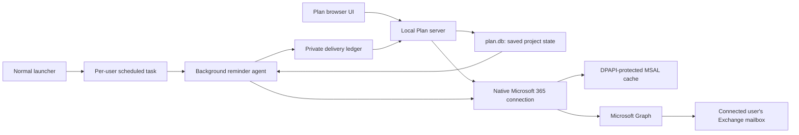

# Windows background reminder agent: implementation plan

Status: proposed; application implementation has not started.

## Goal and user experience

Make email reminders work whenever the user's Windows laptop is awake, signed in and connected, independently of the Plan browser tab and local HTTP server.

The repository must contain the runtime, worker, automatic registration logic and dependencies. Users must not install Python or packages, edit configuration, create an Entra registration, configure Task Scheduler, enter secrets or run setup commands. Microsoft sign-in and any organization-required consent remain necessary. Automatic setup targets standard Windows accounts without elevation; it cannot override Windows management policies or Microsoft 365 tenant restrictions.

Normal experience:

1. Run `start.bat` as usual. It automatically registers or repairs the background task and starts the agent.
2. Click **Connect Microsoft 365** and complete Microsoft's corporate sign-in/consent flow. This establishes the Windows app's shared native connection for reminders, people search and sharing; no application IDs or tenant settings are entered by the user.
3. Enable reminders and edit projects normally. Committed local saves become the worker's source of truth.
4. Close the browser and launcher. The agent continues checking saved projects.
5. At later Windows sign-ins, the agent starts automatically. After sleep or a network outage, it resumes and applies a bounded catch-up policy.
6. Open Plan to see worker health, reminder activity and any sign-in requirement.

Scope is a **per-user background agent supervised by Windows Task Scheduler**, running with ordinary user privileges. It is not an administrator-installed Windows Service. It runs while that user is logged in, including while the session is locked. It does not promise delivery while the laptop is off, asleep, offline or the user is logged out. Do not wake the laptop automatically in the first version.

## Non-admin support and organization approval

There are separate Windows and Microsoft 365 permission boundaries:

| Capability | Standard-user support | Policy boundary |
| --- | --- | --- |
| Run the bundled app and agent | No administrator rights needed by the design | Company application-control policies must permit the executables |
| Register and run the user's own scheduled task | Use `TASK_LOGON_INTERACTIVE_TOKEN` with ordinary privileges and no stored Windows password | Task permissions and managed-device policy must allow registration; user must remain logged in |
| Corporate Microsoft sign-in | No administrator role required for the user | The organization must permit access to the registered application |
| Send from the user's own mailbox | Delegated `Mail.Send` has `AdminConsentRequired: No` | The tenant must allow consent for this app and permission, or an administrator must approve it |
| Silent authorization renewal | Supported through MSAL's native token cache | MFA, sign-in frequency, revocation and Conditional Access can require interaction again |

**No end-user configuration does not guarantee no IT involvement.** A maintainer must provision the application registration before release. Some organizations disable user consent, allow only selected permissions or publishers, or require app assignment/approval. A public application ID in the repository does not grant access by itself.

Request only delegated permissions for the connected user's features. Do not switch to application-wide `Mail.Send`, use a shared service identity, collect passwords or attempt a policy bypass when consent fails.

Expose distinguishable states such as **Sign-in required**, **Organization approval required**, and **Background setup blocked by device policy**, based on actual error evidence. Keep local planning available and pending reminders intact. Do not label a policy-blocked installation as ready or continually retry authorization in the background.

The first feasibility milestone must exercise native delegated mail authorization and per-user task registration on an actual managed laptop using an ordinary corporate account. Record the observed tenant/device requirements; do not infer organizational permission from successful login alone.

## Findings that shape the implementation

- `start.bat` launches the bundled interpreter; `start.py` loads the application from `src`. There is no package installation at user startup.
- `runtime/windows-x64/` is an intact CPython embeddable distribution. Preserve its upstream files and import isolation.
- `src/project_management_tool/__init__.py` serves the UI and SQLite persistence endpoints. It does not execute reminder jobs.
- `web/js/reminders.js` calculates future emails, groups them by task/person/project, renders templates and coordinates browser-driven sync. Automatic sync waits 12 seconds after changes.
- `web/js/m365.js` uses browser MSAL and delegated Graph permissions. It currently creates deferred-send Outlook messages using `SystemTime 0x3FEF`.
- Reminder message IDs live in an account-specific app-state ledger. Past entries are forgotten based on time without verification of sending.
- `ProjectStorage` stores deduplicated app state and retained history in `Documents/Plan/plan.db`. Writes use revision checks. A worker must not manufacture workbook revisions merely to record email activity.
- Existing Microsoft 365 verification uses mocked Graph responses, not a live tenant. Windows agent behavior and real sending must be verified on Windows.

## Architecture and fixed decisions

- The agent owns reminder calculation, reconciliation and sending on supported Windows installations. The browser edits settings and displays previews/status.
- Use the bundled Python runtime. Do not add a Node installation or a browser dependency to background execution.
- Check approximately once per minute using an interruptible wait. Reconcile immediately on startup and after detecting resume or restored connectivity. Polling saved revisions makes correctness independent of UI notifications.
- Send messages when due using delegated `Mail.Send` and `POST /me/sendMail`, with `saveToSentItems: true`. The access token identifies the user's actual Exchange Online mailbox; do not select a sender by supplying an arbitrary `From` address. Outlook does not need to be installed or running. Stop creating new far-future deferred-send messages once migration is complete.
- On Windows, the local server and worker use a shared native authentication module and coordinated protected cache. The browser calls narrow local Microsoft 365 operations; it does not receive access/refresh tokens or maintain a second authoritative Microsoft account. The worker invokes the module directly and never depends on the HTTP server remaining alive.
- Read committed project snapshots through a read-only SQLite connection in short transactions; release database locks before network calls. Do not initialize or repair `plan.db` from the worker. Never send from unsaved browser edits.
- Store worker state under `%LOCALAPPDATA%\Plan\Reminders\<data-directory-id>\`. Keep the delivery ledger outside workbook history and outside browser state.
- Derive a stable data-directory identity from its normalized absolute path, with Windows case/path handling. Scope task identity, singleton ownership and ledger to the Windows user and selected data directory.
- The default Documents location and existing `--data-dir` behavior continue to select the project database. Registration uses absolute paths and the selected data directory explicitly.
- Credentials never enter `plan.db`, `.plan` files, the repository, task arguments, diagnostic exports or ordinary logs.

## Phase 1 — Prove authentication and Windows task feasibility

Complete this phase before replacing the existing scheduler.

### Shared native Microsoft 365 authentication

1. The maintainer provisions a public desktop application registration and ships its non-secret client ID and authority defaults with the repository. Configure the desktop loopback redirect and supported organization audience: a single-tenant release serves that organization; a release for multiple organizations needs a suitable multitenant registration and applicable publisher verification/consent preparation. This is release preparation, not end-user setup. Document the deployment's actual audience and approval requirements.
2. Use a supported native public-client flow with PKCE and silent token acquisition, implemented using a pinned MSAL Python distribution and its required dependencies. Microsoft's system-browser page handles corporate credentials, MFA and consent. An existing corporate session may provide SSO; do not assume it grants the app mail access. No client secret or user password is distributed or collected.
3. Vendor the compatible runtime dependencies and licenses during release preparation. Verify compatibility with the bundled interpreter, isolated import paths and offline startup; no `pip` or dependency download at launch.
4. Persist the MSAL cache encrypted with Windows DPAPI for the current user, with restrictive file permissions and atomic replacement. Serialize cache access between the local backend, interactive authorization and background renewal. Share the native authentication implementation; do not require the worker to contact the local HTTP server.
5. Offer one **Connect Microsoft 365** action, plus explicit reconnect/disconnect controls. Run interactive authentication only in response to a user action; the unattended worker must never launch surprise sign-in windows. Treat the transition from existing browser-only authorization as a native connection step; do not copy or scrape MSAL browser credentials.
6. Request delegated `User.Read` to identify the account and delegated `Mail.Send` when enabling mail features, preferably consented during the initial connect flow when reminders are being enabled. Let MSAL manage the protocol scopes needed for silent renewal. Request directory and OneDrive scopes incrementally when their features are used. `Mail.Send` supports ordinary submissions and Sent Items without `Mail.ReadWrite`; request additional mailbox access only where needed for legacy cancellation or uncertain-send reconciliation, with the reason shown to the user.
7. Resolve the connected profile/mailbox through Microsoft Graph. Bind reminder ownership to stable tenant/account identifiers (including the MSAL home-account identifier and Graph user identity where applicable), rather than an editable email address or display name. Preserve the difference between a login UPN and the mailbox's primary email address. Use this same connection for reminder, people and sharing UI operations.
8. When due, call MSAL's silent token acquisition for the recorded account and required scope, then submit through `POST https://graph.microsoft.com/v1.0/me/sendMail` with `saveToSentItems: true`. Exchange sends from the authenticated user's mailbox; neither an Outlook process nor an Outlook COM integration is required. Treat an absent or inaccessible Exchange Online mailbox as a distinct failure rather than assuming corporate sign-in proves mailbox availability.
9. Distinguish expired/interaction-required authorization, denied consent, organization approval requirements, application access restrictions and device registration failures when supported by the error response. Preserve pending work, display the appropriate status and avoid continuous authentication retries. Delegated `Mail.Send` does not inherently require admin consent, but tenant policy can still require IT approval.
10. Switching accounts must not reassign pending reminders to the new sender. Pause the old account's jobs and require an explicit decision before rebinding eligible projects. Disconnect clears the selected account's native authorization, stops new submissions for it and disconnects its people/sharing operations. Already-submitted mail cannot be recalled by clearing credentials; retain non-secret delivery history and reconcile any in-flight outcome.

Acceptance gate: on real Windows, connect using a standard corporate account, authorize delegated mail access, close all Plan browser windows and the local server, then obtain a token and submit a reminder from the worker. Verify the recipient's actual sender and the user's Sent Items. Repeat after worker restart and Windows sign-out/sign-in. Confirm the app exposes the same account for people/sharing/reminders, that account switching cannot change an existing job's sender, and that disconnect stops new submissions. Record observed approval and Conditional Access requirements; do not promise permanent authorization or that every tenant permits user consent.

### Scheduled task proof

- Register a task for the current user with least privilege and `TASK_LOGON_INTERACTIVE_TOKEN`; no stored Windows password and no elevation prompt. Do not use a boot trigger, another user's identity, `SYSTEM`, elevated run level or S4U as a workaround.
- Start at user logon and start immediately after registration. Allow execution while the session is locked.
- Configure restart on failure, no ordinary execution time limit, and no parallel instances. Battery use and switching to battery must not stop the agent. Do not condition task startup on network availability: the worker must start offline and retry later.
- Start without a visible console using the bundled windowless interpreter, after verifying it is present and compatible. Ensure failures are still recorded locally.
- Use Task Scheduler's supported registration interface with correctly escaped paths and arguments. Test spaces, Unicode and shell metacharacters in installation/data paths.
- Validate non-admin registration under an ordinary Windows account. Managed-device policy restrictions must produce an actionable in-app status; do not silently claim installation succeeded or fall back to browser scheduling.

Acceptance gate: normal launch installs a working task without configuration; the agent survives closing the launcher, restarts after termination and runs after the next user logon.

## Phase 2 — Build the worker's deterministic reminder engine

Proposed modules under `src/project_management_tool/reminder_agent/`:

| Module | Responsibility |
| --- | --- |
| `__main__.py` | Worker entry point and controlled lifecycle commands |
| `registration.py` | Windows task registration, verification, repair and removal |
| `engine.py` | Reminder eligibility, trigger dates, grouping and template rendering |
| `source.py` | Consistent project snapshots and legacy-ledger discovery |
| `ledger.py` | Durable jobs, attempts, leases, migration state and health |
| `auth.py` | Shared native Microsoft 365 connection, DPAPI-protected cache, account identity and consent/error states |
| `graph.py` | Shared allowlisted Graph operations, mail submission, throttling and outcome classification |
| `worker.py` | Polling, reconciliation, catch-up, execution and shutdown |

Names may change during implementation; keep these responsibilities separate.

Port the required planning/rendering behavior to pure Python. Use fixed cross-language fixtures against the existing JavaScript behavior before changing it. Avoid maintaining two independent sending implementations after rollout.

Preserve:

- Per-task, per-person and per-project grouping.
- Calendar-day lead times, chosen send hour and the existing one-day-after-deadline overdue notice.
- Task/milestone deadlines and derived finish dates, including working calendars and scheduling modes. Stored task duration is not necessarily the final deadline: verify results against `store.view(...).info`.
- Summary-row exclusion, completed-task exclusion, task skips, muted recipients and read-only project exclusion.
- Custom templates, supported variables, safe HTML escaping and recipient normalization.

Persist an explicit project reminder timezone when enabling/upgrading reminders. Initialize it automatically from the Windows timezone; do not reinterpret schedules each time the laptop changes timezone. Store execution instants in UTC and define deterministic daylight-saving behavior for ambiguous or nonexistent local hours.

The worker reads the latest saved revision before preparing a batch and revalidates relevant project/task state immediately before submission. If the database is unreadable, pause sending rather than using a stale snapshot. Document that a committed edit after final validation cannot recall mail already submitted to Exchange.

Acceptance gate: fixture parity covers grouping, actual calculated deadlines, templates, suppression and timezone boundaries. The worker runs without a browser or HTTP server and does not create project-history revisions.

## Phase 3 — Durable execution, retries and catch-up

Use a separate SQLite ledger with explicit schema versions. Suggested records:

- Source identity and account identity.
- Stable logical reminder key, grouping scope, trigger occurrence and schedule revision/fingerprint.
- Due instant, eligibility/cancellation state and message-content fingerprint.
- State such as `pending`, `claimed`, `accepted`, `cancelled`, `retry`, `uncertain` or `failed`.
- Attempts, timestamps, next retry time, claim lease, correlation/message identifiers and redacted error details.
- Heartbeat, worker/source version, last successful scan and migration checkpoints.

Execution rules:

1. Use a per-user/data-directory singleton and transactional job claims. Task Scheduler's no-parallel setting alone does not protect against manual worker starts.
2. Reconcile jobs against current saved state. Cancel or replace obsolete pending jobs when deadlines, recipients, completion or settings change.
3. Keep sent/accepted occurrence history across schedule revisions. Content hashes alone must not cause an already-sent trigger to be sent again after an unrelated edit.
4. Honor Graph throttling, `Retry-After` and bounded backoff. Persist retry scheduling across restarts.
5. Distinguish safe retryable failures from ambiguous submission outcomes. A timeout or crash after submission begins becomes `uncertain`; do not blindly resend it. Use Graph correlation/draft inspection where supported, otherwise surface it for explicit resolution.
6. Mark Graph submission as `accepted`, not `delivered`. Delivery failures and bounce handling are separate from an HTTP success response. Do not promise exactly-once delivery through Graph.
7. On restart, reclaim expired work only when it is safe to do so; reconcile attempts that might already have submitted mail.
8. Detect database replacement, history restoration and source changes. Reconcile against retained occurrence history; do not replay historical reminders simply because project revisions moved backwards.

Initial catch-up policy:

- Maintain the existing reminder types; do not introduce recurring overdue mail implicitly.
- After a gap, coalesce missed notifications to the most recent relevant trigger per unfinished task, then apply the configured person/project grouping.
- Skip obsolete pre-deadline reminders once the task is overdue. If overdue notices are enabled, send at most one catch-up overdue occurrence for the current deadline.
- If overdue notices are disabled, do not create a new overdue email as compensation for a missed pre-deadline reminder.
- Use a fixed initial catch-up window of seven calendar days after a missed trigger's scheduled local date. Older occurrences become `skipped_stale` in activity instead of being submitted. For overdue catch-up, apply the window to the existing deadline-plus-one-day trigger. This is a shipped default, requiring no setup; display and document it.
- A newly enabled project must not retrospectively email all old tasks. Record an activation baseline; distinguish initial enablement from recovery after an established agent's outage.

Acceptance gate: interruption and recovery checks demonstrate bounded catch-up, cancellation of obsolete work, no concurrent duplicate submissions and explicit handling of unknown outcomes.

## Phase 4 — Automatic setup, lifecycle and UI integration

### Launcher and task lifecycle

- Add Windows-only registration/repair to the normal launcher path without blocking ordinary offline project startup.
- Verify existing task configuration before changing it. Repeated launches must be idempotent.
- Repair repository relocation on the next normal launch: update executable/source paths for the same data directory and retire the obsolete task definition without leaving another sender running.
- Coordinate updates: stop/pause the worker before source updates, migrate ledger schemas safely and restart through the supported launcher/update flow. Use a source-version check to prevent old processes mixing old and new modules.
- Honor `--data-dir` and preserve intentionally separate data directories. Avoid duplicate tasks for equivalent paths.
- If the repository/runtime is missing at logon, the task cannot execute. Report and repair this on the next valid launch; do not claim portability makes deleted files executable.
- Provide an in-app action to pause background reminders and remove automatic startup. Removing startup alone must not leave an already-running sender active. Retain delivery history so re-enabling does not replay sent occurrences.
- Keep existing macOS/Linux launch behavior intact. Report Windows-only background capability explicitly; do not silently present browser sending as equivalent background support.

### Local integration

- Add narrowly scoped local endpoints for worker health, redacted activity, interactive connect/reconnect/disconnect and lifecycle actions.
- Adapt the Windows `m365.js` interface to use the native connection for profile, people, mail and OneDrive operations. Preserve existing feature behavior and incremental permissions; remove Windows reliance on browser MSAL token storage and user-entered client/tenant configuration.
- Apply the server's local-origin restrictions to mutations. Return only non-secret account/status data; never return token/cache contents. Allowlist supported Graph operations and validate request inputs, rather than exposing an arbitrary URL proxy or arbitrary commands/paths through control endpoints.
- Serve status with the agent stopped or unhealthy; opening the status dialog must not itself submit email.
- Replace Windows browser scheduling with previews and agent status. Remove the 12-second browser-send dependency and prevent legacy send calls once the agent owns the source.
- Show separate states for project save status, background-task installation, account authorization and reminder execution. Distinguish organization approval requirements from ordinary reconnect needs and device-policy setup failures; do not automatically prompt for administrator elevation.
- Surface last scan, last accepted submission, pending/retry/uncertain jobs and actionable errors. Keep diagnostic output redacted and bounded.
- Explain that edits take effect after a successful local save and that reminders resume after sleep/offline periods according to catch-up policy.

Acceptance gate: closing the browser/server does not affect the agent; editing, disabling or deleting reminders updates the worker after the save; unhealthy installation/authentication is visibly distinguishable from healthy operation.

## Phase 5 — Migrate existing deferred Outlook reminders

Migration must precede new worker submissions for each affected account/project. Otherwise Exchange can send a legacy message and the worker can send the same reminder.

1. Discover account-specific `pm-rem-ledger-v1` entries from saved app state. Preserve the original records and create migration checkpoints.
2. Stop legacy browser sending before migration starts, including other open tabs. Introduce a persisted scheduler-ownership/version marker and reject unsupported mixed ownership.
3. Reconcile future legacy messages using the matching account. Cancel verified pending messages before allowing equivalent worker jobs to send.
4. Treat missing messages, uncertain cancellation outcomes and mismatched accounts as cases to reconcile. A `404` alone does not establish whether an email was sent or safely cancelled.
5. Block only the affected scope while its legacy outcome is unresolved; display the reason. Preserve unaffected project operation.
6. Import known occurrence history where evidence supports it. Do not infer delivery solely because an old scheduled timestamp has passed.
7. If the local ledger is missing but legacy scheduled mail may remain, require a bounded mailbox reconciliation/review before enabling overlapping worker sends. Do not promise automatic recovery of unidentifiable legacy messages.
8. Make migration resumable across worker crashes and repeated launches.

Acceptance gate: a live-tenant migration test verifies that a previously queued reminder and its replacement cannot both execute through the normal migration path. Uncertain cases stay visible and blocked rather than guessed away.

## Verification plan

Use isolated data directories, worker ledgers, scheduler task names and authentication profiles. Do not operate on the user's working database or existing production reminder queue during development.

### Automated checks

- Pure planner/template fixtures and JavaScript-to-Python parity, including derived deadlines and calendars.
- Ledger transactions, leases, schema migration, deduplication and database-restore behavior.
- Fake Graph responses for acceptance, throttling, authorization failure, transport failure before submission and ambiguous failure after submission.
- Crash injection before/after claims, during submission and before recording acceptance.
- Clock/timezone changes, resume, multi-day downtime, initial activation, stale backlog and catch-up grouping.
- Registration XML/configuration generation, escaping, idempotent repair and failure reporting.
- Existing persistence/runtime tests and relevant UI regressions; verify worker activity does not mark the editor stale or grow workbook history.
- Secret-redaction and origin checks for the added control/status interfaces, plus rejection of arbitrary Graph proxy targets.
- Shared account identity across browser operations and worker submissions, UPN/mailbox alias differences, explicit account switching and disconnect during pending/in-flight work.
- Consent/Conditional Access error classification, organization-approval messaging and device-policy registration failure without escalation or a misleading ready state.

### Required Windows integration checks

- Fresh clone/folder copy on Windows 10/11 x64 without a separately installed Python or Node runtime.
- First launch offline, standard non-admin account, paths with spaces and non-ASCII characters.
- Actual Task Scheduler registration, task settings, hidden process, immediate start and next-logon start.
- Browser and launcher closed; session locked; agent terminated and restarted; laptop on battery.
- Sleep/resume, reboot, lost/restored connectivity and missed-trigger catch-up.
- Repeated launches, simultaneous starts, folder relocation, source update, custom data directory and removal/reinstallation.
- Ordinary application saves and worker reads at the same time, with a temporary SQLite lock and an unreadable database.
- Real native sign-in, encrypted cache reuse across backend/worker, explicit reconnect and correct account/sender selection.
- Task registration under a standard managed Windows account without elevation, password prompts, elevated run level or a boot trigger. Verify denied-registration reporting on a restricted test setup without changing the organization's policies.

### Required live Microsoft 365 checks

Use a dedicated test mailbox and consenting recipients. Verify actual receipt and timestamps, not just Graph responses.

- Due reminder sent with browser and local server stopped.
- Worker restart and later Windows sign-in preserve authorization where tenant policy permits.
- Complete, reschedule, mute and disable before due time; verify suppression.
- Account switch/revocation and consent-required behavior; pending jobs cannot switch sender implicitly.
- The same native account supports the app's people/sharing/reminder operations; permission expansion remains interactive and feature-specific.
- Delegated mail consent by an ordinary user where tenant policy permits it, plus accurate handling of an approval-required response in a controlled test or mock. Record which paths were exercised on a live tenant.
- Actual sender identity and Sent Items presence, with no Outlook process running.
- Legacy deferred-message discovery/cancellation and interrupted migration.
- Retry and uncertain-send reconciliation with no blind resubmission.

Linux mocks cannot satisfy the Windows or live-mail acceptance gates. Record any gate that cannot be executed as an unresolved release requirement.

## Documentation and release deliverables

- Update `README.md` with automatic setup, sign-in, background operation, laptop availability, catch-up behavior and removal controls.
- Update `docs/testing.md` with isolated worker/task setup, cleanup and the actual verified Windows/live-tenant results.
- Add maintainer instructions for public app registration, single-tenant versus multitenant audience, publisher/organization approval requirements, delegated permissions, vendored authentication dependencies and license/provenance verification. End users should not need to enter these values.
- Explain that the standard-user design requires no local administrator rights on supported devices, while application control, Task Scheduler permissions and Microsoft 365 consent/access policies may still require organization approval. Document the observed approval path without promising policy bypass or zero IT involvement.
- Document private worker state/credential locations, backup behavior, database relocation and recovery. Copying `plan.db` does not copy credentials or constitute a safe migration of pending mail to a second active computer.
- State that v1 coordinates a user/data directory on one laptop. Multiple computers independently sending reminders for copies of the same project are outside its deduplication boundary.
- Ensure release artifacts include all required runtime files and dependency licenses. Preserve `runtime/windows-x64` and user databases.

## Completion criteria

- [ ] A normal `start.bat` launch sets up and starts the agent under a standard Windows account without user configuration, Windows password collection or elevation where device policy permits it; blocked setups report the actual failure.
- [ ] One native Microsoft 365 connection serves the Windows app and worker, with sign-in/consent only and no user-supplied application IDs, tenant configuration, secrets or setup commands.
- [ ] Delegated `Mail.Send` submits from the connected user's actual mailbox and retains Sent Items; Outlook is not required. Organization approval requirements are distinguished from ordinary sign-in needs.
- [ ] Account switching cannot silently reassign pending reminders, and disconnect stops new submissions for that account.
- [ ] The browser and local server can both be stopped while due reminders are submitted and received.
- [ ] Login, crash recovery, sleep/resume and offline recovery pass actual Windows checks.
- [ ] Saved task/settings changes govern eligibility and catch-up; old reminders do not produce a historical burst.
- [ ] Concurrent starts, ambiguous sends and legacy migration have explicit duplicate-prevention/reconciliation behavior.
- [ ] Worker activity leaves project revision/history semantics intact and credentials stay outside exports/logs.
- [ ] Users can inspect health, reconnect authorization and stop/remove the agent inside Plan.
- [ ] Existing planning, persistence and bundled-runtime regressions pass.
- [ ] Documentation accurately distinguishes tested behavior, laptop-availability limits and tenant/device policy limits.

## Microsoft references

- [Microsoft Graph `sendMail`: delegated permission, `/me/sendMail`, Sent Items and acceptance semantics](https://learn.microsoft.com/en-us/graph/api/user-sendmail?view=graph-rest-1.0).
- [Microsoft Graph permissions reference: delegated `Mail.Send` has `AdminConsentRequired: No`](https://learn.microsoft.com/en-us/graph/permissions-reference#mail-send).
- [MSAL Python native interactive sign-in with PKCE, silent acquisition and cache persistence](https://learn.microsoft.com/en-us/entra/msal/python/getting-started/acquiring-tokens).
- [Desktop application registration and loopback redirect configuration](https://learn.microsoft.com/en-us/entra/identity-platform/scenario-desktop-app-registration).
- [Microsoft Entra user/admin consent policies](https://learn.microsoft.com/en-us/entra/identity/enterprise-apps/user-admin-consent-overview).
- [Task Scheduler security contexts and standard-user registration](https://learn.microsoft.com/en-us/windows/win32/taskschd/security-contexts-for-running-tasks).
